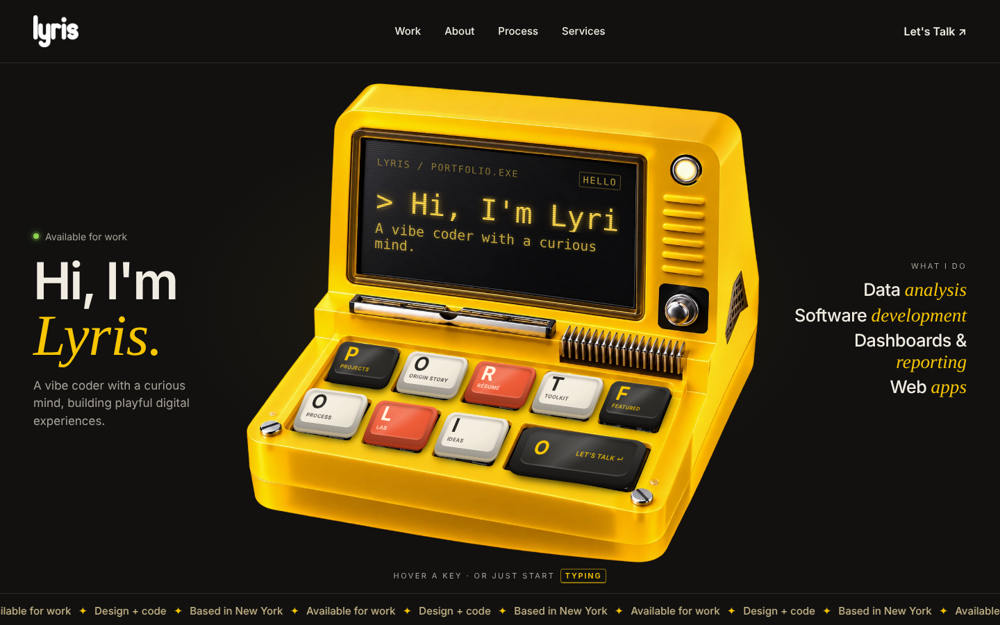

# Lyris Dsilva · Retro Portfolio

A personal portfolio built around a yellow retro computer. The nine keycaps spell **P‑O‑R‑T‑F‑O‑L‑I‑O**, each one opens a page, and the screen types my story on a loop. Start typing on your own keyboard and the letters appear on the screen while the matching keys press down.

**Live site:** https://lyrisdsilva.github.io/Lyris-portfolio/



## About me

I'm a Computer Science master's student at Binghamton University and a Software Developer Intern at IpserLab. I work across SQL, Python, Java and full-stack JavaScript, and I like turning messy data into clear answers and software people use.

- LinkedIn: [linkedin.com/in/lyrisdsilva](https://linkedin.com/in/lyrisdsilva)
- GitHub: [github.com/lyrisdsilva](https://github.com/lyrisdsilva)
- Email: dsilvalyris@gmail.com

## Features

- **Interactive keyboard:** real HTML keycaps placed on a photo of a retro computer, lined up in perspective at every screen size.
- **Typing screen:** a small typing engine writes my story letter by letter, then backspaces and moves to the next line.
- **Type along:** whatever visitors type shows up on the screen, and keys with the same letter press down.
- **Typing wave:** every 10 seconds the keys hop one after another, P to O.
- **Separate pages:** Work, project case studies, About, Experience, Services, Résumé, Toolkit and Lab.
- **Responsive:** three columns on desktop, stacked and centred on tablets and phones, with no sideways scrolling.
- **Accessible:** every key is a real link you can reach with Tab, the photo has alt text, and animations switch off for visitors who turn on "Reduce motion".

## Built with

- HTML, CSS and vanilla JavaScript, with no frameworks and no build step
- CSS container query units (`cqw`) and `@property` for the animated keycap height
- Fonts: Clash Display and Cabinet Grotesk (Fontshare), Instrument Serif and VT323 (Google Fonts)

## Project structure

```
Lyris-portfolio/
├── index.html              Home page with the keyboard
├── work.html               All projects, with filters
├── project-*.html          One page per project
├── about.html
├── experience.html
├── services.html
├── resume.html
├── toolkit.html
├── lab.html
├── style.css               Styles shared by every page
├── site.js                 Name, email and scrolling strip (shared settings)
├── home.js                 Typing screen, keycaps and typing wave
├── device.webp             Retro computer photo
├── logo.png                Lyris wordmark
├── me.jpg                  Portrait
└── resume-data-analyst.pdf
```
## Credits

- Concept and layout based on the "Retro Portfolio Machine" design handoff, including the retro computer artwork.
- Design and development by Lyris Dsilva.
